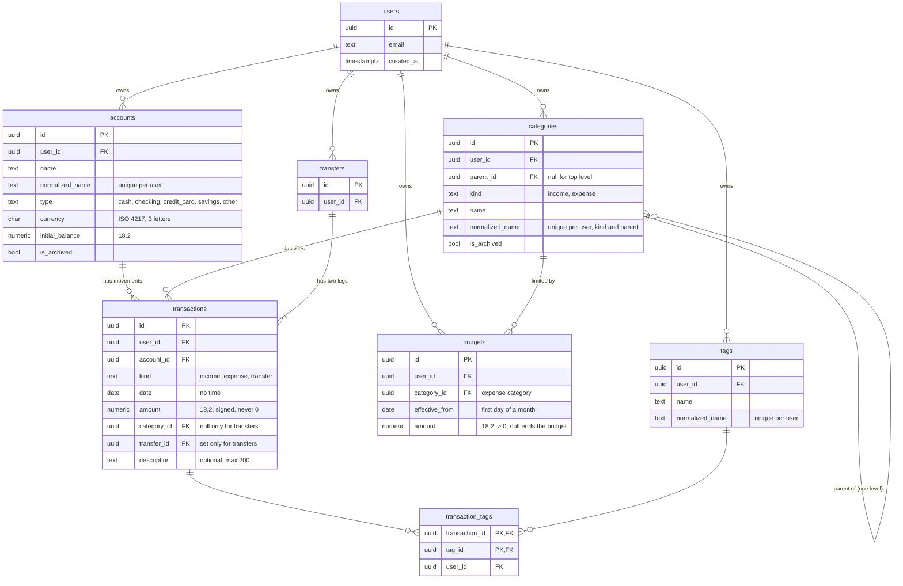

# Domain model

## Scope

The entities of the MVP (accounts, categories, transactions, transfers, budgets, tags), their relationships, and the business rules that protect money correctness: account balance, transfers as two linked movements, budget progress. Naming, types and indexes are in [conventions.md](conventions.md); per-user isolation in [user-isolation.md](user-isolation.md).

## Current state

Decided ([ADR-0010](../architecture/adr/0010-data-model-and-user-isolation.md)). **Entities and rules implemented** in the `Domain` project with their unit tests; mapping and the first migration arrive in `Infrastructure` (`feat/backend-persistence`).

### Code map

| Module | Folder in `backend/src/Domain` | Types |
|---|---|---|
| Common | `Common/` | `OwnedEntity` (id, owner, timestamps), `IOwnedByUser`, `DomainException`, `DomainErrors` (stable codes), `Amounts`, `Texts` |
| Accounts | `Accounts/` | `Account`, `AccountType` |
| Categories | `Categories/` | `Category`, `CategoryKind` |
| Transactions | `Transactions/` | `Transaction`, `TransactionKind`, `Transfer`, `Tag`, `TransactionTag` |
| Budgets | `Budgets/` | `Budget`, `BudgetPolicy`, `BudgetProgress`, `YearMonth` |

- **Identifiers** are generated by the domain at creation (`Guid.CreateVersion7()`): a transfer knows its id before its legs are created, and nothing waits for the database.
- **Facts the domain cannot see** (whether an account has movements, a category has subcategories or is in use, which categories are budgeted) are passed by the caller as parameters; the slice loads them with a query. The rule stays in the domain and is unit tested.
- Errors are `DomainException` with a code from `DomainErrors`, e.g. `transfer.same_account`, `budget.branch_conflict`.

### Entity–relationship diagram

Identity tables other than `users` are omitted. Every table except `users` and the link table `transaction_tags` has `created_at` and `updated_at`; editable tables also use the PostgreSQL `xmin` column as concurrency token ([conventions.md](conventions.md#concurrency)).



Every foreign key between user-owned tables also includes `user_id` (e.g. `transactions(user_id, account_id) → accounts(user_id, id)`): see [user-isolation.md](user-isolation.md#composite-foreign-keys).

### Entities

| Entity | Table | Notes |
|---|---|---|
| `ApplicationUser` | `users` | `IdentityUser<Guid>` in `Infrastructure`, plus `CreatedAt`. Not a domain entity: the domain only knows `UserId` |
| `Account` | `accounts` | Name, type, currency, initial balance, archived flag |
| `Category` | `categories` | Kind (income or expense), optional parent, archived flag |
| `Transaction` | `transactions` | One movement on one account. Income and expense have a category; transfer legs have none |
| `Transfer` | `transfers` | Groups the two legs of a transfer; date, amount and description live in the legs |
| `Tag` | `tags` | Free label, unique per user without regard to case |
| — | `transaction_tags` | Link between transactions and tags |
| `Budget` | `budgets` | One entry of a category's monthly limit, valid from `effective_from` until the next entry |

Every domain entity receives its `UserId` at creation — explicitly (`Account`, `Category`, `Tag`) or from the entity it belongs to (a transaction from its account, a transfer from its source account, a budget from its category) — and exposes no setter for it ([user-isolation.md](user-isolation.md#interceptor)).

### Amounts

- `decimal` in C#, `numeric(18,2)` in PostgreSQL.
- **More than two decimals are rejected**, never rounded: `12.345` is an error, not `12.34` or `12.35`.
- **Zero is rejected** for every movement and budget.
- **Sign** (stored as it is):

| Movement | Stored amount |
|---|---|
| Income | positive |
| Expense | negative |
| Transfer, source leg | negative |
| Transfer, destination leg | positive |

The domain takes positive amounts from callers (`Money` must be > 0) and applies the sign itself, so a slice never chooses a sign.

### Business rules

#### Account balance

```
balance(account, up to date D) = initial_balance + Σ amount of the account's transactions with date ≤ D
```

- Computed, never stored. The current balance uses every transaction.
- Negative balances are allowed.
- The domain method and the SQL query must give the same result: an integration test compares them.
- An archived account keeps its balance and appears in reports; it cannot receive new movements.
- The **currency** can change only while the account has no movements; afterwards a new account is needed (changing it would reinterpret every amount).
- An account can be **deleted** only while it has no movements (`Account.EnsureCanDelete`, `account.has_movements`); afterwards it can only be archived, so no history is lost.

#### Income and expense

- The category is required and must have the same kind (`income` → income category, `expense` → expense category).
- Account and category must belong to the same user and not be archived. When a transaction is changed, the archived check applies only to an account or category newly chosen: an existing movement of an archived account can still be corrected.
- A transaction can change date, amount, category, account and description; its kind never changes (delete and recreate instead).

#### Transfer

- Created from: source account, destination account, date, positive amount, optional description.
- Produces **two legs** on the same date: `-amount` on the source, `+amount` on the destination, same description.
- Rejected when: source and destination are the same account; the accounts have different currencies (MVP); an account is archived; the amount is zero, negative or has more than two decimals.
- Changing a transfer changes both legs; deleting it deletes both.
- The database allows at most one negative and one positive leg per transfer; the domain always creates both.

#### Categories

- One level: a subcategory cannot have children, and a category with children cannot become a subcategory.
- A subcategory has the same kind as its parent.
- The **kind** (income or expense) can change only for a top-level category without subcategories that no transaction or budget uses; afterwards a new category is needed. A subcategory always has the kind of its parent.
- Names are unique per user, kind and parent, without regard to case (`Spesa` and `spesa` collide; an income and an expense category may share a name).
- Archiving a parent archives its subcategories.

#### Budget and progress

A budget is a history of entries per expense category:

| `effective_from` | `amount` | Meaning |
|---|---|---|
| 2026-01-01 | 300.00 | 300 € per month from January |
| 2026-06-01 | 350.00 | 350 € per month from June |
| 2026-09-01 | null | No budget from September |

- `effective_from` is always the first day of a month; one entry per category and month.
- **Limit of month M** = the entry with the latest `effective_from` ≤ first day of M; no entry, or an entry with `null`, means no budget for M.
- **Spent in month M** = −Σ amount of expense transactions of the category **and its subcategories** with date in M (from the first to the last day, inclusive).
- **Progress** = spent / limit, computed in `decimal`; it can exceed 1 (over budget). **Remaining** = limit − spent, negative when over budget. Rounding happens only when displaying.
- Budgets are allowed only on expense categories.
- **One level per branch**: a budget can be set on a parent category **or** on its subcategories, never on both, so the same expense is never counted in two budgets and the total of budgets is always a plain sum. Setting a budget on a parent that has budgeted subcategories (or the opposite) is rejected; moving a budgeted category under a budgeted parent is rejected too. A category counts as budgeted when it has at least one budget entry, ended or not: switching level means deleting the entries of the other level first.
- Months are plain calendar dates (`DateOnly`): no time zone is involved.

#### Tags

- Created on the fly when a transaction is tagged; reused by normalized name.
- Deleting a tag removes it from its transactions; deleting a transaction removes its links.

### Default categories

Every new user receives a default set of categories: [default-data.md](default-data.md).

## Decisions

| Decision | Reason | Reference |
|---|---|---|
| Signed amounts, sign chosen by the domain | `SUM(amount)` everywhere; no sign logic in queries or slices | [ADR-0010](../architecture/adr/0010-data-model-and-user-isolation.md) |
| Transfer = `transfers` row + two legs | Both sides change together; the database rejects extra legs | [ADR-0010](../architecture/adr/0010-data-model-and-user-isolation.md) |
| Computed balance | Always consistent with the movements | [ADR-0010](../architecture/adr/0010-data-model-and-user-isolation.md) |
| Budget entries with `effective_from` | Set once, history kept | [ADR-0010](../architecture/adr/0010-data-model-and-user-isolation.md) |
| Archive accounts and categories | Deleting would lose or orphan history | [ADR-0010](../architecture/adr/0010-data-model-and-user-isolation.md) |
| Budgets on a parent or on its subcategories, never both | No expense counted twice; the total of budgets is a plain sum | This document |
| Account currency and category kind fixed once used | Changing them would make existing movements inconsistent | This document |
| Category required on income and expense | Budgets and per-category reports stay complete; a default "Altro" category exists for quick entry | This document |
| Domain errors as `DomainException` with a stable code | Mapped once to ProblemDetails by the API | [ADR-0010](../architecture/adr/0010-data-model-and-user-isolation.md) |

## Tests

Unit tests in `Domain.Tests` ([testing.md](testing.md#domain-unit-tests)):

- amounts: zero, negative where not allowed, three decimals, the largest value of `numeric(18,2)`;
- balance: no movements, only income, only expense, mixed, negative result, movements after the given date excluded;
- transfer: two legs with opposite amounts and same date, same account rejected, different currencies rejected, archived account rejected, update moves both legs;
- income and expense: wrong category kind, archived account or category;
- account: currency change allowed without movements, rejected with movements; delete allowed without movements, rejected with movements;
- categories: second level rejected, kind different from the parent rejected, archiving a parent, kind change allowed only without transactions and budgets;
- budget: budget on a parent with budgeted subcategories rejected and the opposite, moving a budgeted subcategory under a budgeted parent rejected, limit picked from the latest entry, ended budget, first and last day of the month, February in a leap year (2028), subcategories included, over budget, remaining negative.

Integration tests in `Infrastructure.Tests` check that constraints enforce the same rules at database level and that the balance query matches the domain. The balance the API computes is compared with the domain too (`AccountsTests.Get_Balance_AddsEveryMovement_AndEqualsTheDomainBalance`).

## Scalability

- **Volumes**: computed balances are fine for tens of thousands of movements per user thanks to the `(user_id, account_id, date)` index. Beyond that, monthly balance snapshots maintained by a worker.
- **Different currencies**: each leg already has its own amount on its own account; allowing different currencies means accepting two amounts and storing the rate on the transfer.
- **Refunds on an expense category**: today a refund is recorded as income. Allowing positive amounts on expense categories means relaxing one `CHECK` and redefining "spent".
- **Recurring transactions, CSV import** (roadmap): new tables referencing accounts and categories with the same composite keys; imported rows are ordinary transactions.
- **Budget overrides for a single month**: a flag on the entry, or a separate table, on top of the current history.
- **Attachments** (roadmap): a table referencing `transactions(user_id, id)`, files outside the database.

## To do / open questions

- `[Backend]` Whether the API exposes signed amounts or absolute values plus kind.
- `[Frontend]` Category icons and colors (new columns when needed).
- Refunds on expense categories (see Scalability), to decide when the first need appears.

---
_Last updated: 2026-11-12_
